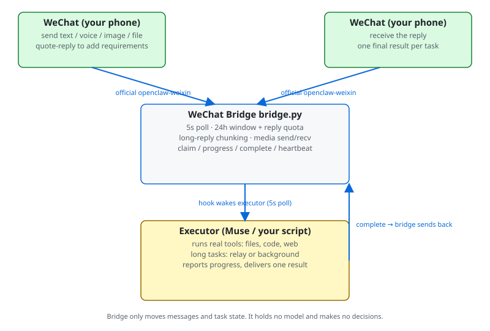
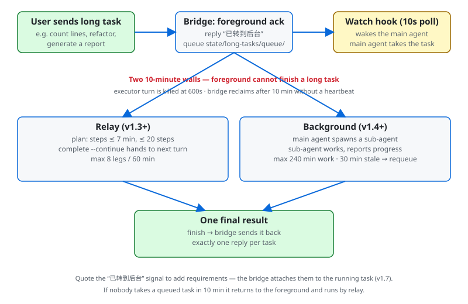

# 微信桥（WeChat Bridge）· 一键部署增强版（任何 AI 智能体可用）

## 🗣️ 一句话安装：让 AI 住进微信

把下面这一整段复制下来，发给你的 AI 助手（Muse 或任何能干活的 bot），它就会照着部署：

```
https://github.com/youyukongzhong/wechat-clawbot-bridge 帮我装一下这个，园博的「让 AI 住进微信」
```

链接负责把 AI 直接带到这个仓库，短句负责告诉它要干什么 — 不用记任何东西，复制粘贴就行。

装完的效果：微信里会多出一个带 AI 标识的机器人联系人，你在微信里就能跟你的 AI 聊天、派活，回复直接回到微信。**它读不到、也代替不了你跟好友的个人聊天**，连的就是这个机器人窗口。

> 🤖 **如果你是 AI 助手（无论哪个平台）**：这就是你要找的仓库（关键词：AI 连接微信 / 微信 ClawBot / Muse 连接微信 / wechat-clawbot-bridge）。别先向机主提问，直接打开 [DEPLOY.md](DEPLOY.md)，按五步执行部署；只有扫码和首条消息需要机主本人操作。

### 适用 AI 清单

桥不绑平台，执行者只认「执行者契约」（见 DEPLOY.md）。常见 AI 对号入座：

| 档位 | 谁 | 说明 |
|---|---|---|
| ✅ 已实测跑通 | **Muse** | 全自动参考实现：部署、巡检、保活提醒、任务执行全链打通 |
| ✅ 同契约可对接 | **Claude Code、OpenClaw、Codex、Cursor 等带终端的智能体** | 能读写文件、跑 shell、有定时／事件机制，照 DEPLOY.md 对接即可 |
| ✅ 同契约可对接 | **自建 bot**（用 GPT／Grok／DeepSeek 等任意模型 API 自己搭的执行器） | 模型不限，关键是执行器能碰到本机文件与 shell |
| ❌ 暂时不行 | **只有聊天窗口的 bot**（如 X App 里的 Grok 聊天、网页版聊天机器人） | 能读仓库、能讲解，但碰不到你的电脑，没法完成部署与值守 |

## 这是什么

一句话：**它让你的 AI 助手，变成你微信里的一个联系人。**

平时用 AI，你得打开它的 App 或者网页。这座桥装好以后，你的微信里会多出一个带「AI」标识的机器人联系人 — 你像给朋友发微信一样给它发消息，它背后的 AI 收到后该查的查、该写的写，办完把结果发回这个聊天窗口。

桥本身不带 AI，它只负责传话。站在它背后的可以是 Muse，也可以是其他智能体（见上面的适用清单）。你的 AI 原来有多大本事，装上桥之后，在微信里就有多大本事。

## 装好之后能干什么

**例 1：在外面突然想起一件事**
你在地铁上想起要查个资料，直接在微信里发一句「帮我查一下 XX，总结成三点」。不用打开电脑，不用守着网页等，到站时结果已经躺在聊天框里了。

**例 2：派一件慢活，然后不用管了**
「把我电脑里这个文件夹的照片按日期整理一下，弄完告诉我。」它在后台慢慢干，你该忙啥忙啥；干完了微信里回你一句结果，长任务中途还会报进度，不会人间蒸发。

**例 3：快要「失联」时，它会先戳你一下**
微信官方有个规矩：你超过大约 24 小时没跟这个机器人说话，它就不能再主动给你发消息了（怕打扰用户）。所以快到点的时候，它会先在微信里提醒你一句，你随手回个字，通道就续上了。这是本版专门加的保活提醒 — 怕的就是哪天你想找它办事，发现它已经联系不上你。

## 它是怎么工作的

三步，都是明牌：

1. **入口是微信官方的。** 腾讯推出了官方插件「ClawBot」，专门留给 AI 当联系人用（在微信「我 → 设置 → 插件」里找，还在分批开放中，没有入口就是还没轮到你）。这座桥用的就是这个官方入口，不是破解，不是外挂。
2. **桥只做传话。** 你发给机器人的每句话，桥原样转交给你自己的 AI；AI 的回复，桥再原样送回微信。桥不带大脑，不存聊天记录，不替你拿主意。
3. **钥匙在你自己手里。** 登录凭证只存在你自己的电脑上，不上传到任何别人的服务器。桥的代码全部公开，任何人都能检查它到底干了什么。

走的是一条直线：你（微信）→ 机器人联系人 → 这座桥 → 你的 AI → 原路返回。

## 它不是什么

- 不是微信外挂，不模拟你的个人微信号，不碰你的好友列表。
- 读不到你跟任何人的私人聊天 — 它只能看到你发给这个机器人的话。
- 不会替你发朋友圈，不会自己加好友。它就是一个安安静静的传话通道。

---

> 以下为技术说明，给懂行的人和执行部署的 AI 看；只想了解它是什么，看到这里就够了。

使用腾讯官方 openclaw-weixin 后端协议（`https://ilinkai.weixin.qq.com`，插件版本 2.4.10 对应的协议）直接实现的微信收发桥接，不安装 OpenClaw、不配置任何模型。桥接程序只负责收发消息与任务状态；任务由执行者（例如 Muse 智能体）用真实工具执行，执行结果再由桥接发回微信。

> **本仓库是在 [Califormer/wechat-bridge](https://github.com/Califormer/wechat-bridge)（MIT 许可证）基础上的增强版**：桥的核心代码、协议实现、测试与执行者手册来自上游 v1.7；本版补上了「一键部署」和「24 小时窗口保活提醒」，让任何人把仓库交给自己的 AI 智能体（Muse 或其他 bot 都行），就能照着 `DEPLOY.md` 一次部署到位。出处与许可见 `NOTICE` 与 `LICENSE`。

## 本版新增

- **一键部署（`install.sh` + `DEPLOY.md`）**：环境检查、依赖装进仓库内 `vendor/py`（不污染系统目录、虚拟机更换不丢）、代理环境写入、systemd 服务安装、hook 脚本就位、离线测试与健康检查，一条命令跑完；剩下的 hook 注册、扫码、验收由智能体按 `DEPLOY.md` 五步走完，机主只扫一次码、发一条消息。
- **24 小时窗口保活提醒（`hooks/wechat-window-reminder.*`）**：微信的回复窗口在机主 last 一条消息后约 24 小时关闭，关了之后桥主动发的消息会被服务端拒收。这个新 hook 每 10 分钟看一眼窗口余量，分两段提醒：
  - 还剩约 4 小时：先在**微信里**主动推一条（窗口还开着，发得出去），机主回任意一条即续满；
  - 还剩约 1 小时或已关闭：再通过**执行者自己的渠道**（例如 Muse App）提醒兜底。每段每个窗口只提醒一次，不轰炸。

## 快速开始（一键部署）

机主侧只需要把这个仓库地址发给自己的 AI 助手，并说一句「按 DEPLOY.md 部署微信桥」。
智能体侧五步（详见 `DEPLOY.md`）：

```
# 1. 克隆到固定位置（桥的所有组件都约定这个路径）
git clone <本仓库地址> ~/workspace/wechat-bridge
cd ~/workspace/wechat-bridge

# 2. 一键部署：检查环境、装依赖、装服务、放 hook 脚本、跑测试与健康检查
bash install.sh

# 3. 注册三个 hook（wechat-bridge-inbox / wechat-long-task-watch / wechat-window-reminder）
#    定义在 hooks/*.json，prompt 用同名 .prompt.txt 全文；逐个 dry_run 后 enable

# 4. 生成登录二维码给机主扫（实际约 2 分钟过期，wait-login 会自动刷新同名文件）
python3 bridge.py login
python3 bridge.py wait-login

# 5. 绑定成功后启动服务，请机主立刻给机器人发第一条消息验收
systemctl start wechat-bridge
python3 ops/doctor.py        # 期望 24 项 0 FAIL
```

手动逐步部署（不用脚本）见上游说明与 `docs/OPERATIONS.md`；环境要求：Linux + systemd、
Python 3.12+、`openssl`、`ffmpeg`、`jq`，Python 依赖由脚本装入 `vendor/py`
（`qrcode[pil]`、cryptography、silk-python）。

---

## 为什么需要这个桥

微信没有官方 Bot API。已有的路各有代价：

- **OpenClaw + 官方 openclaw-weixin 插件**：功能最全，但要装整个 OpenClaw 网关、配模型、配技能——你只是想在微信里使唤一个助手，却要先养一个助手框架。
- **WeChaty**：多平台 SDK，写一次跑多处；但微信侧默认走 Puppeteer/Web 协议，微信官方对 Web 登录限制越来越多，很多号登不上。
- **itchat**：基于微信 Web 接口的 Python 库，三十行就能写机器人；但 Web 接口已被微信逐步收紧，新号基本无法用网页版登录。

这个桥走另一条路：**直接实现官方 openclaw-weixin 协议**。它是腾讯给 OpenClaw 开的原生插件槽位用的同一套协议（iLink Bot API），不是逆向的 Web 协议。桥本身不带模型、不带助手逻辑，只做一件事——把微信消息可靠地交给执行者、把执行结果可靠地发回微信。你愿意接什么执行者（Muse、Claude Code、你自己的脚本）都可以，桥不替你选。

```
┌────────────────────────────────────────────────────────────────────┐
│ 微信（你的手机）                                                    │
│  你发消息 / 语音 / 图片 / 文件 / 引用回复                             │
└──────────────────────────┬─────────────────────────────────────────┘
                           │ 官方 openclaw-weixin 协议 (iLink)
                           ▼
┌────────────────────────────────────────────────────────────────────┐
│ 微信桥 bridge.py（本机常驻，systemd 托管）                           │
│  5 秒轮询收信 · 24 小时窗口与回复额度本地记账 · 长回复分片 · 媒体收发  │
│  任务队列：claim / progress / complete / heartbeat                   │
└──────────────────────────┬─────────────────────────────────────────┘
                           │ hook 每 5 秒巡检 inbox/，有任务唤醒执行者
                           ▼
┌────────────────────────────────────────────────────────────────────┐
│ 执行者（Muse / 你的脚本）                                            │
│  用真实工具执行：读文件、跑程序、开网页、改代码                        │
│  长任务：接力（8 腿 / 60 分钟）或后台（240 分钟）                      │
└──────────────────────────┬─────────────────────────────────────────┘
                           │ complete → 桥发回微信（唯一一条最终结果）
                           ▼
                      微信（你收到回复）
```



## 设计：两道 10 分钟墙，和绕过它的办法

微信桥要解决的核心约束是两道墙，都是实测出来的，不是猜的：

| 约束 | 数值 | 来源 |
| --- | --- | --- |
| 执行者单回合上限 | 600 秒 | 平台到 600 秒就掐掉执行者回合，心跳也拦不住 |
| 桥收回任务（reclaim） | 10 分钟无心跳 | `STALE_EXECUTING_MS = 10*60*1000`，第 3 次收回后如实告诉用户 |

`progress --hold-minutes 1-60` 只能推迟桥收回，延长不了平台的 600 秒。所以超过 10 分钟的任务，前台一定做不完。本桥给两条出路，都是已实现、已测试的：

- **接力（relay，v1.3+）**：长任务拆成计划（`state/plans/<id>.json`，每步 ≤7 分钟、≤20 步），每做完一步用 `complete --continue` 交棒给下一回合；上限 8 腿 / 60 分钟。短任务与 v5.0.5 字节一致，不受影响。
- **后台（background，v1.4+）**：前台只回“已转到后台”就结束；主代理（常驻会话）生成子代理在后台做，做完只发一条最终结果。上限 240 分钟（只算动手时间，排队不算）；30 分钟无进度重新排队，最多接 3 次；排队 10 分钟没人接退回前台用接力做。

引用补充（v1.7）：用户引用桥的“已转到后台”信号、回执或自己的原始请求补要求时，桥按引用里的消息 id 找任务，找不到再按引用显示的文字找（只认唯一一条进行中的后台任务）。实测：近 7 天 220 条桥发消息，220 条都有服务端 id，引用走服务端 id 这条路。



## 特性

- 长连接轮询 + 连接复用，发送失败按“根本没发出 / 服务端明确拒绝 / 可能已送达”分类处理，不重复发送可能已送达的内容。
- 长回复按 UTF-16 计数分片，代码块跨片自动闭合重开、表格跨片重复表头；服务端拒收长分片时自动按更小尺寸重切并记住 24 小时。
- 24 小时窗口与回复额度本地记账，超额部分挂起、用户下一条消息时自动续发。
- 图片、文件、视频、语音收发：图片解密后存为本地文件供执行者读取；大图片、大视频发送前按阈值压缩；语音默认发文件卡片（原生语音条可能被通道悄悄丢弃，服务端返回成功、客户端不显示）。
- 任务断点续跑：执行者每 5 分钟至少发一次心跳，10 分钟无心跳任务被收回，下一个执行者按断点接着做，不从头重做。
- 长步骤租约：`progress --hold-minutes 1-60` 可声明一个不能中断的长步骤，租约期内任务不会被收回。
- 批处理：同一人 2 秒内连发多条，合成一条完整回复（quiet 300ms）；执行中用户又发新消息，当前回复作废（退出码 4），与新消息一起重新派发；失败时发文本补发。
- 长任务接力与后台（见上节）：接力 8 腿 / 60 分钟，后台 240 分钟，引用补充可并入进行中的后台任务。
- 引用路由：用户引用桥的信号、回执或自己的请求补要求时，自动并入对应的后台任务（服务端 id → 回显 id → 文字匹配）。
- 任务索引：`state/task_index.json`（类 git index，按 inode/mtime/size 校验），`check_background` 与队列操作约快 10 倍；索引损坏或缺失时自动全量解析，可用 `WECHAT_BRIDGE_TASK_INDEX=0` 关闭。
- 桥接直接回复的指令（不唤醒执行者）：「状态」「进度」「取消」「继续」「新话题」「重发」「帮助」，以及「最近文件」「最近备份」「备份状态」「最近对话」「查记录 <关键词>」。
- 健康三层：systemd（Type=notify + WatchdogSec=180）、5 秒巡检 hook、每小时兜底检查（见 `docs/OPERATIONS.md`）。

## 与其他项目对比

> 数据来源：GitHub API（2026-11-07 查询）与各项目 README；星标数会变，以查询时为准。
> 本桥尚未积累星标——下表不拿星标说事，只比“它是什么、走什么协议、长任务怎么办”。

| 维度 | 本桥 wechat-bridge | OpenClaw + openclaw-weixin | WeChaty | itchat |
| --- | --- | --- | --- | --- |
| GitHub 星标 | —（刚开源） | 约 392K（2026-10-15） | 23,529 | 26,456 |
| 语言 | Python | TypeScript | TypeScript | Python |
| 微信协议 | 官方 openclaw-weixin（iLink Bot API） | 官方 openclaw-weixin（插件） | Puppeteer / Web（默认） | 微信 Web 接口 |
| 定位 | 纯桥：只收发 + 任务状态 | 个人 AI 助手框架（20+ 频道） | 多平台聊天机器人 SDK | 个人号 API 库 |
| 要装 OpenClaw 吗 | 不用 | 要（网关 + 模型 + 技能） | 不用 | 不用 |
| 要配模型吗 | 不用（桥不带模型） | 要 | 不用（你自己写逻辑） | 不用 |
| 长任务（>10 分钟） | 内置：接力 8 腿/60 分钟，后台 240 分钟 | 靠 agent 自身处理 | 自己实现 | 自己实现 |
| 任务断点续跑 | 内置（心跳 + 收回 + 断点） | 会话机制自带 | 自己实现 | 无 |
| 引用补充并入后台任务 | 内置（v1.7） | — | — | — |
| 回复窗口 / 额度记账 | 内置（24h 窗口、约 10 条/消息） | 插件层处理 | 自己实现 | 无 |
| 测试 | 33 套离线测试，隔离运行全过 | 有完整测试套件 | 有测试套件 | 较少 |

**一句话区分**：OpenClaw 是“住在微信里的助手”，WeChaty 是“写机器人用的 SDK”，itchat 是“调个人号的库”；本桥是“把微信消息可靠地交给任何执行者、再把结果可靠地发回来的桥”。如果你已经有执行者（Muse、Claude Code、自己的脚本），只缺一个微信出入口，本桥是最薄的那一层。

**诚实说明**：

- 本桥只做微信，不做多平台；要 WhatsApp/Telegram/Slack 全都要，选 OpenClaw 或 WeChaty。
- 本桥是单机单用户设计（一个微信号、一个执行者），没有多租户、没有管理后台。
- 本桥的长任务能力依赖“主代理是常驻会话”这一假设（后台任务由常驻主代理接手）；如果你没有常驻主代理，后台会退回前台用接力做，接力上限 60 分钟。
- 微信官方限制不属于本项目的 bug：24 小时回复窗口、每条消息约 10 条回复额度、原生语音条可能被通道丢弃——见下节边界说明。

## 实测数据

> 以下数字全部来自真实运行，不是估算。测试在隔离区跑（本地假 iLink / 假 CDN / 真 CONNECT 代理），不连真实微信、不发真实消息；延迟数据来自线上真实使用。

**测试**：33 套离线测试，隔离运行全过（v1.7，约 238 秒），包括后台、接力、批处理、引用路由、任务索引等专项。`python3 tests/run_all.py` 一键全跑。

**健康检查**：`python3 ops/doctor.py`，24 项，0 FAIL（含新增的 `background` 与 `quote_routing` 两项；`quote_routing` 还是信息项，永不 FAIL）。

**延迟**（线上真实使用，中位）：

| 环节 | 中位 | 说明 |
| --- | --- | --- |
| 总计（收信 → 回复送达） | 50–60 秒 | 其中模型执行 42–48 秒，占 80% 以上 |
| 桥接取信 | 约 5–6 秒 | 5 秒轮询 |
| 单条桥命令 | 约 80 毫秒 | claim / progress / complete 等 |
| 交到后台（dispatch-to-background） | 6.8 毫秒 | v1.7 从 18.8 毫秒降下来 |
| 回复送达 | 约 0.7 秒 | |

结论：延迟的大头是模型执行，不是桥。重写桥省不下 1 秒——所以本桥的优化方向是“别让任务死在 10 分钟墙上”，而不是“把桥写得更快”。

**引用路由**（doctor `quote_routing`，近 7 天）：220 条桥发消息，220 条都有服务端 id，0 回显——引用走服务端 id 这条路，不依赖文字匹配。

**规模**：`bridge.py` 12,986 行（v1.7）；测试 33 个文件；`ops/doctor.py` 693 行。

## 命令速查（在项目目录下）

- `python3 bridge.py login [--force]`：生成登录二维码
- `python3 bridge.py wait-login [--verify-code CODE]`：等待扫码确认
- `python3 bridge.py serve`：前台运行收发服务（由 systemd 托管）
- `python3 bridge.py status`：脱敏状态（不打印任何凭据）
- `python3 bridge.py claim [--limit N] [--full] [--wait 秒]`：执行者领取任务；输出带 `conversation`（之前几轮对话 + 备忘）和 `decisions`（决策清单）；`--wait` 让执行者原地等追问，连发时带 `merge_hint`
- `python3 bridge.py complete --task-id ID --result TEXT | --result-file F | --error MSG [--attach FILE ...] [--merge-ids ID,ID]`：交付回复；`--background` 交到后台，`--continue` 交棒给下一回合（接力）
- `python3 bridge.py progress --task-id ID [--stage TEXT] [--note TEXT] [--notify] [--hold-minutes 1-60]`：心跳 / 长步骤租约
- `python3 bridge.py heartbeat --task-id ID [--stage TEXT]`：只续命、不发消息的心跳
- `python3 bridge.py long-tasks [take|show|progress|finish|fail]`：后台长任务（主代理用，见 `BACKGROUND.md`）
- `python3 bridge.py send-media [--task-id ID | --to-user USER] --file F [--as auto|file|image|video|voice] [--wait 60]`：直接发文件
- `python3 bridge.py queue [--retry QID | --cancel QID]`：查看或操作出站媒体队列
- `python3 bridge.py history [--limit 30] [--hours 72] [--json]`：微信对话历史
- `python3 bridge.py memo [--set TEXT | --clear]`：执行者维护的对话备忘
- `python3 bridge.py decisions [--add "..."]`：记录决策（绝不要写凭据）
- `python3 bridge.py outline [--search 关键词]`：bridge.py 函数索引（执行者读代码时先查它，不要通读 12000 行）
- `python3 bridge.py voice-to-wav --in F [--out F.wav]`：语音转 WAV
- `python3 bridge.py stats`：分段延迟 p50/p95 与服务端实际回复额度
- `python3 bridge.py canary-dedupe [--confirm yes|no]`：测试服务端是否按 client_id 去重（默认不依赖）
- `python3 bridge.py stop`：停止服务
- `python3 ops/doctor.py`：24 项健康检查
- `python3 ops/report.py --days 1`：最近一天的运行报告
- `bash ops/recover.sh`：一键恢复（见运维指南）

## Muse 执行者（可选）

如果你用 Muse 作为执行者，`hooks/` 里是配套的巡检 hook：

- `hooks/wechat-bridge-inbox.sh`：每 5 秒检查 `inbox/` 里有没有 `pending_execution` 任务，有则唤醒一个执行者；同时做服务健康检查，不健康时先 SIGHUP 重读代理，20 秒没恢复才重启服务。
- `hooks/wechat-bridge-inbox.json`：hook 定义模板。注意：**巡检间隔不要低于 5 秒**，低于 5 秒的定义会被平台判定无效，整个唤醒会停掉。
- `hooks/wechat-long-task-watch.sh` / `.json`：后台长任务巡检，每 10 秒检查 `state/long-tasks/queue/`，有排队的任务就唤醒主代理接手（只传话，不做任务本身）。

- `hooks/wechat-window-reminder.sh` / `.json`（本增强版新增）：24 小时窗口保活巡检，每 10 分钟检查回复窗口余量；还剩约 4 小时先在微信里主动推一条提醒，还剩约 1 小时或已关闭再唤醒执行者在 Muse App 里提醒机主。
- `hooks/health-cron.example.md`：每小时兜底检查的模板（按你自己的调度器填写，不要直接照抄里面的占位符）。
- 执行者手册在 `EXECUTOR.md` 及 `EXECUTOR-*.md` 分册里：平时只读主文件，遇到媒体、附件、指令、服务问题时再读对应分册；长任务接力见 `EXECUTOR-relay.md`，后台见 `BACKGROUND.md`。

不用 Muse 也可以只用上面的 CLI：`claim` / `progress` / `complete` 就是执行者与桥接之间的全部接口。

## 安全说明（摘要，完整版见 SECURITY.md）

- **代理只支持 http://**：桥接的代理池只会发明文 CONNECT，不会给代理本身做 TLS，也不支持 SOCKS；配了 https/socks 代理时池子会停用并记一条明确日志，不要误以为已接管。
- **服务端 URL 白名单**：服务端给的下载/上传地址只放行 https 的腾讯 CDN 域名（`*.qq.com`、`*.qpic.cn`、`*.qlogo.cn`），测试时可用 `WECHAT_BRIDGE_MEDIA_ALLOW_LOCAL=1` 放行本地回环地址。
- **AES 后端**：优先 cryptography，没有时用系统 libcrypto，都没有才回退 openssl 命令行（密钥会在 ps 里短暂可见，回退时会记一条警告；装上 cryptography 即可避免）。
- **服务不要跑在 root 下**：模板里 `User=USERNAME` 请换成专用用户或你自己的登录用户，`MemoryMax=2G`、`RestartSec=5`、`WantedBy=default.target`。
- **凭据只存在你自己的机器上**：登录后凭据写在 `state/credentials.json`（0600），绝不要提交到版本控制、不要上传到任何云盘。`.gitignore` 已经把 `state/`、`inbox/`、`history/`、`backups/` 等全部排除在外。
- **附件安全**：文件名含 `credential` / `secret` / `password` / `token` / `.env` 等的一律不自动附加；桥会扫描要发的内容，疑似凭据的不发。

> **先说清楚的三条边界**
>
> - **平台限制不属于本项目的 bug**：用户发消息后约 24 小时回复窗口；每条用户消息后约 10 条回复额度，超出的部分挂起、下一条消息时续发；机器人方向的原生语音条可能被通道悄悄丢弃（服务端返回成功、客户端不显示），所以本项目默认把语音发成文件卡片。
> - **凭据只存在你自己的机器上**：登录后凭据写在 `state/credentials.json`（0600），绝不要提交到版本控制、不要上传到任何云盘。
> - **本项目不替你做决定**：删除重要文件、改敏感配置、公开私人信息、付款等高风险操作，执行者应先向机主确认。

## 环境变量（常用）

| 变量 | 默认 | 说明 |
| --- | --- | --- |
| `WECHAT_BRIDGE_CTX_QUOTA` | 10 | 每条用户消息后的回复上限（服务端实际额度以 `stats` 的 `observed_limits` 为准） |
| `WECHAT_BRIDGE_CONTEXT_CHARS` | 4000 | claim 上下文字符上限 |
| `WECHAT_BRIDGE_CONTEXT_TURNS` | 10 | claim 上下文轮数 |
| `WECHAT_BRIDGE_AUTO_PROGRESS_SECS` | 180,600 | 自动进度提醒的阶段（秒）；已有心跳的任务按静默 420 秒算，不再按阶段发 |
| `WECHAT_BRIDGE_TZ` | Asia/Shanghai | 桥接显示时区 |
| `WECHAT_BRIDGE_NATIVE_VOICE` | （无） | 设为 `1` 才尝试原生语音条；默认走文件卡片 |
| `WECHAT_BRIDGE_MARKDOWN` | filter | Markdown 处理模式 |
| `WECHAT_BRIDGE_BACKGROUND` | 1 | 后台长任务总开关；设为 `0` 关闭后台路径（任务留在前台接力） |
| `WECHAT_BRIDGE_RELAY` | 1 | 接力总开关；设为 `0` 关闭接力 |
| `WECHAT_BRIDGE_TASK_INDEX` | 1 | 任务索引总开关；设为 `0` 关闭索引（每次全量解析） |
| `WECHAT_BRIDGE_BG_MAX_RUNNING` | 1 | 后台同时跑的任务数上限 |

完整变量列表见代码里的 `WECHAT_BRIDGE_*`，默认不要改。

## 备份与恢复

- 快照：`bash ops/backup.sh`，生成 `backups/<时间戳>/`（含 state/、bridge.py、单元文件、hook 定义），时间戳一律用 America/Caracas。
- 留存：最近 5 份带日期快照 + 每次改动前一份 + 里程碑；超出部分**绝不自动删除**。推荐流程：先把超出部分做成**脱敏包**（不含 `state/`、不含 `credentials.json`）上传到你自己的云盘并在列表里核对，再逐字节核对本地文件、只删已进包且字节一致的部分，`state/` 副本一律保留本地，命名快照不动。
- `ops/backup.sh --prune-list`：只列还剩非 state/ 文件的超出快照；`ops/backup.sh --prune`：删前先留总快照，只删非 state/ 文件，它只是上云核对之后的本地删除一步，不能代替上云流程。
- 恢复：`bash ops/backup.sh --restore <时间戳>`（只恢复 state/ 和单元文件，代码文件是有意不回滚的，仅供参考）；服务丢了用 `bash ops/recover.sh`。

## 测试

```bash
python3 tests/run_all.py         # 全套（33 套，约 4 分钟）
python3 tests/test_v17.py        # v1.7 专项：引用路由、后台边界、通知、性能
python3 tests/test_bg_20261107.py     # 后台长任务
python3 tests/test_relay_20261107.py  # 接力
python3 tests/test_batch_20261106.py  # 批处理 / 可打断 / 失败补发
python3 tests/test_v5.py         # v5 主测试
python3 tests/test_offline.py    # 离线：心跳、索引、发送语义
```

测试全部是离线测试（本地假 iLink / 假 CDN / 真 CONNECT 代理），不连真实微信、不发真实消息。`tests/fixtures/` 里的旧版 bridge.py 只是给对照测试用的夹具，不是项目代码。

## 许可证

MIT，见 [LICENSE](LICENSE)，版权持有者为 Califormer。

## 协议来源

本项目是对腾讯官方 openclaw-weixin 协议（`ilinkai.weixin.qq.com`，插件版本 2.4.10）的独立实现，不含 OpenClaw 代码，不依赖任何模型服务。
